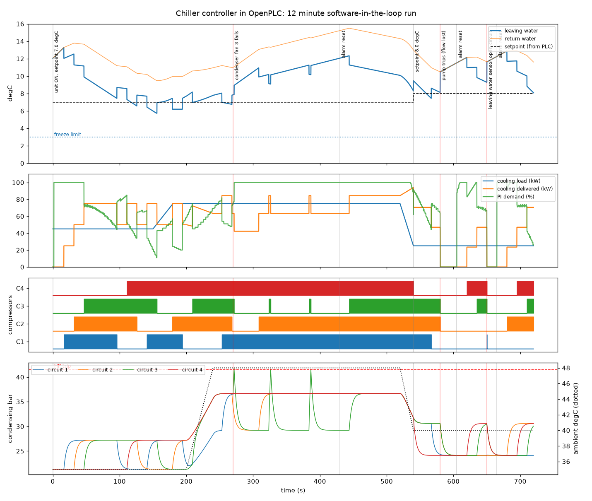

# Chiller controller in Structured Text (PLC + BMS + software-in-the-loop test)

Control software for a 4-compressor air-cooled chiller, written in **IEC 61131-3 Structured Text** and running in a real PLC runtime (**OpenPLC**, 100 ms task). The PLC talks to the plant over **Modbus TCP remote I/O** and to a **building management system (BMS)** over its own Modbus TCP server. A Python plant model closes the loop, and an automated **software-in-the-loop (SIL) test** plays a 12 minute scenario with a 48 °C ambient, a condenser fan failure, a pump trip and a sensor failure, then checks every requirement.



**Validation documents:** [Functional Specification](docs/functional_specification.md) (21 testable requirements) and [Requirements Traceability Matrix](docs/traceability_matrix.md) (requirement → code → test → result, with the open test gaps listed).

## Architecture

```
        BMS / SCADA  (here: the test script)
             │  Modbus TCP :5502   enable, setpoint, alarm reset  /  status, alarms, run hours
             ▼
   ┌───────────────────────────────┐
   │ OpenPLC runtime, plc/chiller.st│   10 Hz task
   │  FB_Compressor x4  FB_PI       │
   │  FB_HpCircuit x4   FB_Alarm x3 │
   │  FB_Hyst x4 (condenser fans)   │
   └───────────────────────────────┘
             │  Modbus TCP :5021, polled every 20 ms
             ▼
   Remote I/O + plant model (sim/plant.py)
   water loop · 4 refrigerant circuits · R410A condensing pressure · fans · pump · flow switch
```

## I/O point list

| Tag | PLC address | Type | Range / unit | Description |
|---|---|---|---|---|
| T_LW | %IW100 | AI | x10 °C | Leaving chilled water temperature (control sensor) |
| T_RW | %IW101 | AI | x10 °C | Return chilled water temperature |
| T_AMB | %IW102 | AI | x10 °C | Outdoor ambient temperature |
| P_COND_1..4 | %IW103..106 | AI | x10 bar | Condensing pressure, circuits 1 to 4 |
| FLOW_SW | %IX100.0 | DI | 1 = flow | Chilled water flow switch |
| PUMP | %QX100.0 | DO | 1 = run | Chilled water pump |
| COMP1..4 | %QX100.1..4 | DO | 1 = run | Scroll compressors |
| FAN1..4 | %QX100.5..7, %QX101.0 | DO | 1 = run | Condenser fans, one per circuit |
| ALARM_RELAY | %QX101.1 | DO | 1 = alarm | Common alarm output |

**BMS interface** (Modbus holding registers, OpenPLC maps %MW0 to register 1024):

| Register | Word | Direction | Meaning |
|---|---|---|---|
| 1024 | %MW0 | BMS → PLC | Unit enable (0/1) |
| 1025 | %MW1 | BMS → PLC | Leaving water setpoint x10 °C (valid 4.0 to 15.0, default 7.0) |
| 1026 | %MW2 | BMS → PLC | Alarm reset command (PLC clears it after use) |
| 1034 | %MW10 | PLC → BMS | Leaving water x10 °C |
| 1035 | %MW11 | PLC → BMS | Active setpoint x10 °C |
| 1036 | %MW12 | PLC → BMS | Capacity demand % |
| 1037 | %MW13 | PLC → BMS | Compressors running |
| 1038 | %MW14 | PLC → BMS | Alarm word: bit 0 flow, 1 freeze, 2 sensor, 3..6 HP trip circuit 1..4, 7..10 lockout circuit 1..4 |
| 1039 | %MW15 | PLC → BMS | State: 0 off, 1 waiting for flow, 2 running, 3 tripped |
| 1040..1043 | %MW16..19 | PLC → BMS | Starts per compressor |
| 1044..1047 | %MW20..23 | PLC → BMS | Run time per compressor (s) |

## Sequence of operation

1. **Start.** When the BMS enables the unit, the chilled water pump starts. Compressors are only permitted once the flow switch proves flow.
2. **Capacity control.** A PI loop (Kp 25 %/K, Ti 60 s, anti-windup by conditional integration) turns the leaving water error into a capacity demand of 0 to 100 %. Each compressor is 25 %.
   * **Stage up** when demand is more than 5 % above the running capacity, at most one step every 15 s. The available compressor with the **fewest run hours** starts (rotation).
   * **Stage down** when demand is more than 5 % below the capacity of one stage less. The running compressor with the **most run hours** stops.
   * **Low leaving water (below 4.0 °C):** shed one compressor every 3 s to protect against freezing.
3. **Compressor protection** (FB_Compressor): minimum ON 20 s, minimum OFF 40 s, start-to-start 60 s. These are scaled 1:9 for the simulation and stand for 3, 6 and 9 minutes on a real unit. A safety trip stops a compressor at once and overrides the minimum ON time.
4. **Head pressure control.** Each circuit's condenser fan runs above 20 bar and stops below 16 bar (hysteresis).
5. **High pressure (FB_HpCircuit).** At 41.5 bar the circuit trips. It resets automatically below 30 bar, and after **3 trips it locks out** until an operator reset. The other circuits keep running.
6. **Unit trips (latching, need a BMS reset):** flow lost for 2 s while the pump runs, leaving water below 3.0 °C (freeze), leaving water sensor out of range (open or short circuit). All compressors stop.
7. **Alarms** are published as a bit word to the BMS and drive the common alarm relay.

## Software-in-the-loop test

`sim/run_sil.py` acts as the plant and the BMS at the same time and logs every signal at 10 Hz. Results from the last run (full report: [results/sil_report.md](results/sil_report.md)):

**14 of 14 requirements pass.**

| Requirement | Result | Detail |
|---|---|---|
| Minimum ON time (20 s) on every normal stop | PASS | 15 stops, 8 were safety trips (allowed to override), 0 violations |
| Minimum OFF time (40 s) before every restart | PASS | 18 starts, 0 violations |
| Start-to-start time (60 s) | PASS | 0 violations |
| Leaving water held at setpoint (110 to 150 s): mean < 0.75 K, max < one stage step + 0.5 K | PASS | mean error 0.57 K, max 1.58 K (one stage step = 1.25 K) |
| BMS setpoint change applied | PASS | PLC reports 8.0 degC after the write |
| Leaving water settles at the new setpoint (555 to 580 s) | PASS | mean error 0.31 K, max 0.62 K |
| No freeze (leaving water stays above 3.0 degC) | PASS | lowest leaving water 5.72 degC |
| 48 degC ambient: no HP trip with all fans working | PASS | highest condensing pressure 36.7 bar (trip 41.5) |
| Fan 3 failure: circuit 3 trips on high pressure, others keep running | PASS | 3 trips of circuit 3, circuits 1/2/4 running 93 % of the time |
| Lockout after 3 high-pressure trips | PASS | circuit 3 locked out at 387 s |
| Circuit 3 back in service after repair and reset | PASS | compressor 3 restarted after the reset |
| Flow loss stops every compressor | PASS | all compressors off 0.2 s after the pump trip (compressors drop out on the flow permissive at once; the latched flow alarm follows after its 2 s delay) |
| Flow alarm latched, no restart until reset | PASS | alarm held after flow came back; compressors restarted only after the reset |
| Sensor failure stops the unit | PASS | all compressors off 0.1 s after the sensor failed, sensor alarm raised |

## Compressor duty (from the PLC over Modbus)

| Compressor | Starts | Run time (s) |
|---|---|---|
| 1 | 4 | 446 |
| 2 | 4 | 495 |
| 3 | 7 | 339 |
| 4 | 3 | 484 |

## What the test taught me

1. **The first accuracy requirement was wrong, not the controller.** I asked for ±0.5 K, but with 4 fixed-speed compressors one stage moves the leaving water by about 1.25 K, so the temperature saws around the setpoint by design. The requirement now follows the physics: mean error under 0.75 K and no deviation beyond one stage step plus 0.5 K. A real unit would add a variable-speed compressor or a buffer tank to tighten it.
2. **A test must give the controller a fair chance.** My first setpoint-change test happened right after the fan fault at 48 °C, when the unit had only just enough capacity, so it could not reach the new setpoint inside the window. The test now changes the setpoint in the evening, when capacity is available. The real shortfall at 48 °C with one circuit locked out stays visible in the chart: that is a sizing limit of the plant, not a control fault.
3. **IEC names are case-insensitive.** `Comp1` (a function block instance) and `COMP1` (an output) are the same name to the compiler, and `DT` is a reserved type. Small things, but they are exactly what breaks a first compile on a new platform.

## Run it

```bash
pip install pymodbus==3.8.6 numpy matplotlib
./plc/setup_openplc.sh /path/to/OpenPLC_v3       # loads the program and the remote I/O map
/path/to/OpenPLC_v3/start_openplc.sh
python sim/run_sil.py --plc-port 5502            # 12 minute run, writes results/
python sim/run_sil.py --analyse-only             # re-check the last run
```

## Limitations

* The plant is a simplified model (one thermal mass, fitted R410A pressure curve), not a validated chiller model.
* Timers are scaled 1:9 so a full scenario fits in 12 minutes.
* On a real unit the high-pressure switch and the freeze stat are hardwired safety devices; the PLC logic here is the second layer.

**Author:** Saadna Ilyes, final-year Industrial Networks & AI engineering student · [GitHub](https://github.com/ilyessaadna10) · [LinkedIn](https://linkedin.com/in/ilyes-saadna) · ilyessaadna4@gmail.com
